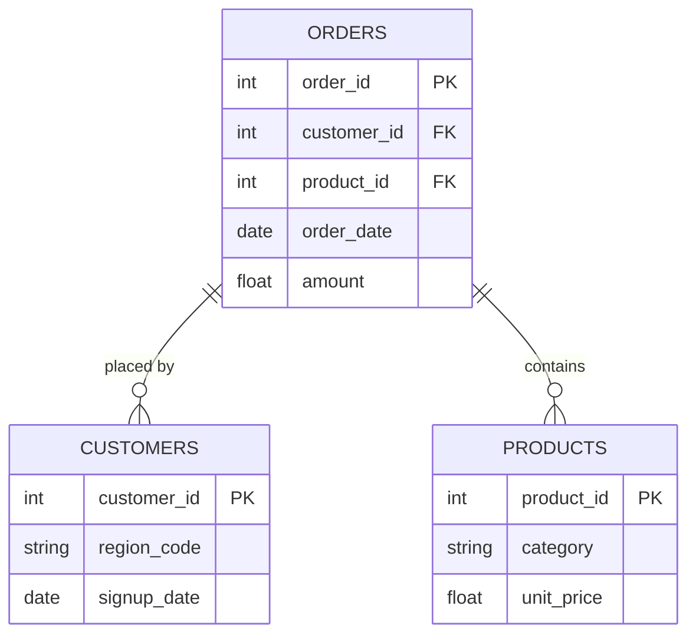

# [Project Title]
> *One sentence. What did you analyze, build, or solve - and why does it matter?*

---

## ⚙️ Project Type Flags
> *Check what applies. This helps reviewers and collaborators understand the nature of the work at a glance. Delete this block before publishing.*

- [ ] Exploratory Data Analysis (EDA)
- [ ] SQL Analysis / Querying
- [ ] Dashboard / Data Visualization
- [ ] Data Pipeline / ETL
- [ ] Predictive Modelling / Machine Learning
- [ ] Data Cleaning / Wrangling
- [ ] End-to-End (multiple of the above)
- [ ] Other: ___________

---

## Table of Contents
1. [Project Overview](#1-project-overview)
2. [Objectives](#2-objectives)
3. [Project Scope & Tools](#3-project-scope--tools)
4. [Repository Structure](#4-repository-structure)
5. [Data Workflow](#5-data-workflow)
6. [Data Model & Schema](#6-data-model--schema)
7. [Analysis--DAX-measures](#7-Analysis--DAX-Measures) 
8. [Analysis & Metrics](#8-analysis--metrics)
9. [Key Observations](#9-key-insights)
10. [Recommendations](#10-recommendations)
11. [Attribution](#11-assumptions--limitations)
12. [Future Enhancements](#12-future-enhancements)
13. [Deliverables](#13-deliverables)
14. [Author](#14-author)

---

## 1. Project Overview

<!--
The Sales Performance & Regional Analysis Dashboard is a Power BI project exploring sales, profitability, product categories, customer demographics, and regional performance.

The report uses sales data alongside customer and product information to demonstrate how Power BI can be used to analyse business performance through interactive visualisations, data relationships, and DAX calculations.

The project includes a Regional Analysis page and additional pages exploring DAX measures, calculated columns, and different Power BI visualisation techniques.

The report covers sales performance across the years 2019–2022 in the Regional Analysis page, with the precise overall dataset coverage to be confirmed from the source files.

This project was completed as a learning exercise to practise Power BI report development, data modelling, DAX, and data visualisation.
-->

**Context:** [The business, research, or personal situation that motivated this project.]

**Problem Statement:** [The specific question or challenge you were addressing.]

**Approach:** [In 1–2 sentences - how did you tackle it?]

**Outcome:** [What did you produce or discover?]

---

## 2. Objectives

<!--
  Write objectives that are specific enough to succeed or fail.
  Use action-oriented verbs: Identify, Determine, Quantify, Build, Evaluate.

  WHAT GOOD LOOKS LIKE:
  ✅ "Determine whether customer churn rate correlates with support ticket volume."
  ✅ "Identify the top three revenue-driving product categories across all regions."
  ✅ "Build a reproducible pipeline that ingests and cleans daily sales exports."

  WHAT TO AVOID:
  ❌ "Explore the data."
  ❌ "Gain insights."
  ❌ "Understand trends."
  (These can't fail - which means they can't succeed either.)
-->

- **Primary Objective:** [The main thing you set out to do]
- **Secondary Objective 1:** [Supporting goal]
- **Secondary Objective 2:** [Supporting goal]
- **Secondary Objective 3:** [Remove if not applicable]

> 💡 *Every analysis decision in this project traces back to one of these objectives.*

---

## 3. Project Scope & Tools

### Scope

<!--
  WHAT GOOD LOOKS LIKE:
  In Scope: "Transaction-level data for Regions A–E, Jan 2023–Jun 2024.
             Analysis covers revenue, return rates, and product category performance."
  Out of Scope: "Customer demographics and marketing spend data were excluded -
                 demographic data was incomplete for two regions, and marketing
                 data sits in a separate system outside this engagement."

  WHAT TO AVOID:
  ❌ Leaving Out of Scope blank. This is the section that protects your credibility.
     If you don't define the fence, reviewers assume you missed things.
-->

| Dimension | Details |
|-----------|---------|
| **In Scope** | [What is included - data sources, time periods, segments] |
| **Out of Scope** | [What you explicitly excluded - and a brief reason why] |
| **Time Period** | [Date range of the data or the project itself] |
| **Granularity** | [Unit of analysis - row-level, daily aggregates, per-user, etc.] |

### Tools & Technologies

<!--
  List only what you actually used on this project.
  This is not your skills section - it's the project's technical context.
-->

| Category | Tool(s) Used |
|----------|-------------|
| Data Storage | [e.g., PostgreSQL, CSV files, BigQuery, S3] |
| Data Processing | [e.g., Python, R, SQL, Excel, dbt] |
| Analysis | [e.g., pandas, dplyr, custom SQL queries] |
| Visualization | [e.g., Matplotlib, Tableau, Power BI, Looker] |
| Version Control | [e.g., Git / GitHub] |
| Documentation | [e.g., Markdown, Notion] |
| Other | [Any additional tools] |

---

## 4. Repository Structure

```
[project-root]/
│
├── data/
│   ├── raw/                  # Original, unmodified source data - never edited
│   ├── processed/            # Cleaned and transformed data
│   └── external/             # Reference data, lookup tables, third-party files
│
├── notebooks/                # Jupyter, R Markdown, or Colab notebooks
│
├── scripts/                  # Reusable .py, .R, or .sh processing files
│
├── queries/                  # SQL files (retain this folder for SQL-heavy projects)
│   ├── exploratory/          # Ad-hoc or investigative queries
│   ├── transformations/      # Cleaning and reshaping logic
│   └── final/                # Production-ready or presentation queries
│
├── reports/                  # Final outputs: PDFs, slide decks, Word docs
│
├── visuals/                  # Exported charts, dashboard screenshots, ERD diagrams
│
├── docs/                     # Data dictionaries, schema notes, reference material
│
├── project_metadata.yml      # Machine-readable metadata (optional)
└── README.md                 # You are here
```

> ⚠️ *Delete folders you didn't use. An empty folder is worse than no folder.*
> SQL-heavy projects: keep `queries/`. Analysis-only projects: keep `notebooks/`. Both? Keep both.

---

## 5. Data Workflow

<!--
  Show how data moved through your project - from source to output.
  Every transformation decision should be traceable here.

  WHAT GOOD LOOKS LIKE:
  1. Source: "Monthly CSV exports pulled from the internal POS system.
              Five files, one per region, covering Jan 2023–Jun 2024."
  2. Ingestion: "Loaded into Python using pandas. Files concatenated into
                 a single dataframe (approx. 340,000 rows)."
  3. Cleaning: "Removed 1.2% of rows with null transaction IDs.
                Standardised date formats across regional files.
                Resolved product category naming inconsistencies (3 variants → 1)."
  4. Transformation: "Created a returns_rate field at product-category level.
                      Aggregated to weekly and regional grain for trend analysis."
  5. Analysis: "Descriptive statistics, regional comparison, return rate
                segmentation by product category."
  6. Output: "Summary report (PDF), annotated notebook, processed CSV."

  WHAT TO AVOID:
  ❌ "Data was cleaned and analysed." (No chain. No decisions. No trust.)
-->

```
[Data Source(s)]
      ↓
[Ingestion / Collection Method]
      ↓
[Cleaning & Transformation]
      ↓
[Analysis / Modelling / Querying]
      ↓
[Output / Visualisation / Reporting]
```

1. **Source:** [Where did the data come from? Format, size, access method.]
2. **Ingestion:** [How was it brought in?]
3. **Cleaning:** [What issues did you find and fix?]
4. **Transformation:** [What new fields, aggregations, or structures did you create?]
5. **Analysis:** [What methods - statistical, visual, query-based, model-based?]
6. **Output:** [What form do the results take?]

---

## 6. Data Model & Schema

<!--
  Define your fields so that someone reading your analysis can follow along
  without digging through your code.

  WHAT GOOD LOOKS LIKE (one row example):
  | transaction_id | string | Unique identifier per sales transaction | TXN-00482 |
  | return_flag    | boolean | Whether the transaction included a return | TRUE |
  | region_code    | string | Two-letter identifier for store region | "NE" |

  WHAT TO AVOID:
  ❌ Skipping this section because "the field names are self-explanatory."
     They're not. Not to a reviewer. Not to you in six months.

  📌 FOR SQL PROJECTS: If you have multiple tables, create one block per table.
     Describe join keys and relationships here. Your ERD (Section 7) will
     visualise what this section describes in text.

  📌 FOR NON-SQL PROJECTS: Describe the shape of your dataset informally
     if a formal schema doesn't apply. Even one paragraph is more helpful than nothing.
-->

### Dataset / Table: `[name]`

| Field Name | Data Type | Description | Example Value |
|------------|-----------|-------------|---------------|
| `[field_1]` | [string / int / date / float / boolean] | [What this field represents] | [Non-sensitive example] |
| `[field_2]` | [string / int / date / float / boolean] | [What this field represents] | [Non-sensitive example] |
| `[field_3]` | [string / int / date / float / boolean] | [What this field represents] | [Non-sensitive example] |

> **Row count (approx.):** [X rows]
> **Date range:** [Start] – [End]
> **Key join / relationship:** [e.g., `orders.customer_id` → `customers.id`]

*Add additional table blocks as needed for multi-table projects.*

---

## 7. ERD - Entity Relationship Diagram
### *(Primarily for SQL Projects - remove this section if not applicable)*

<!--
  An ERD shows how your tables connect to each other visually.
  It is the fastest way for a reviewer to understand the data structure
  of a SQL project without reading every query.

  HOW TO INCLUDE YOUR ERD:
  Option A - Image embed (most common):
    Export your ERD from dbdiagram.io, DBeaver, Lucidchart, or similar.
    Save to /visuals/erd.png and reference it below.

  Option B - dbdiagram.io code block (version-controllable):
    Paste your schema definition code directly in the fenced block below.
    Anyone can paste it into dbdiagram.io to regenerate the visual.

  Option C - Mermaid diagram (renders natively in GitHub):
    Use the mermaid code block syntax below.
    GitHub will render this as a diagram automatically.

  PICK ONE. Don't use all three. Delete the options you don't use.
-->

### Option A - Embedded Image

*[Brief caption: e.g., "Three-table schema - orders, customers, and products joined on shared IDs."]*

---

### Option B - dbdiagram.io Schema Definition
```
Table orders {
  order_id    int     [pk]
  customer_id int     [ref: > customers.customer_id]
  product_id  int     [ref: > products.product_id]
  order_date  date
  amount      float
}

Table customers {
  customer_id int  [pk]
  region_code string
  signup_date date
}

Table products {
  product_id   int    [pk]
  category     string
  unit_price   float
}
```
*Paste this into [dbdiagram.io](https://dbdiagram.io) to view the visual.*

---

### Option C - Mermaid Diagram *(renders on GitHub)*


---

**Table Relationships Summary:**

| Relationship | Join Key | Type |
|-------------|----------|------|
| `orders` → `customers` | `customer_id` | Many-to-One |
| `orders` → `products` | `product_id` | Many-to-One |
| [Add rows as needed] | | |

---

## 8. Analysis & Metrics

<!--
  Explain what you measured and how - before you share what you found.

  WHAT GOOD LOOKS LIKE:
  Metric: "Customer Return Rate"
  Definition: "Number of transactions flagged as returns divided by total
               transactions, calculated at product-category and regional grain."
  Why It Matters: "Return rate - not sales volume - was hypothesised to
                  explain regional revenue gaps. This metric tests that hypothesis."

  WHAT TO AVOID:
  ❌ Defining a metric only in code: SUM(returns) / COUNT(transaction_id)
     That's an implementation. Write the plain-language definition here.
     Both belong in your project - the definition in the README,
     the implementation in the code.
-->

### Analytical Approach

[Describe how you approached the analysis. Were you exploring patterns? Testing a hypothesis? Building and validating a pipeline? Be honest about your method - exploratory work is valid, just call it that.]

### Key Metrics Defined

| Metric | Plain-Language Definition | Why It Matters |
|--------|--------------------------|----------------|
| `[Metric 1]` | [What it measures, in one sentence] | [What decision or question it answers] |
| `[Metric 2]` | [What it measures, in one sentence] | [What decision or question it answers] |
| `[Metric 3]` | [What it measures, in one sentence] | [What decision or question it answers] |

### Methods Used

- [e.g., Descriptive statistics - distribution, central tendency, outlier detection]
- [e.g., Trend analysis across [time period]]
- [e.g., Segmentation / group comparison by [dimension]]
- [e.g., Correlation analysis between [variable A] and [variable B]]
- [e.g., SQL window functions for [specific aggregation]]
- [e.g., Custom aggregation or transformation logic in [tool]]

---

## 9. Key Insights

**Insight 1: [Sales by Product Category]**
For the selected West region:
Furniture generated the highest sales.
Technology ranked second.
Office Supplies generated the lowest sales among the three categories.


**Insight 2: [Customer Age Distribution]**
The documented customer distribution is:

Age category    Count     Percentage

Middle aged      105      41.18%

Senior           94       36.86%

Young            56       21.96%

Middle-aged customers represent the largest group in the documented view, while young customers represent the smallest.

These figures describe the selected dashboard view and should not be generalised to all regions unless the filter context is removed or the broader results are verified.


**Insight 3: [Sales and Profit by Year]**
The Regional Analysis page compares sales and profit across 2019, 2020, 2021, and 2022 for Furniture, Office Supplies, and Technology.
The supplied notes report that profit increased significantly from 2019 to 2022. Exact values and percentage changes have not yet been documented, so no numerical growth claim is made here.


---

## 10. Recommendations


| Priority | Recommendation | Based On | Suggested Owner |
|----------|---------------|----------|-----------------|
| High |  Compare sales and profit across regions to identify where additional analysis may be useful. |Use the yearly comparisons to identify changes that warrant further investigation. | Regional Sales Directors & Business Intelligence Team |
| High |Examine sales alongside profit to understand whether high sales correspond to stronger profitability.| [Insight it comes from] | Chief Financial Officer & Commercial Strategy Lead|
| Medium |Examine whether customer distributions vary across regions or segments. | [Insight it comes from] | Marketing Analytics Manager & CRM Administrator |
| Medium | Examine sales alongside profit to understand whether high sales correspond to stronger profitability. | [Insight it comes from] | Financial Planning & Analysis |
| Medium |Review the marketing-category classification, fixed target values, and colour thresholds before using them for actual business decisions. | [Insight it comes from] | Marketing Operations Director & Data governance Lead |

---

## 11. Assumptions & Limitations
### Assumptions
- The marketing-category classification is based on specified state names and should not be interpreted as an independently validated marketing segmentation.
- The precise overall dataset date coverage should be confirmed from the source files.
- The documented Regional Analysis page compares 2019–2022.

### Limitations
-The fixed sales multiplier and target-profit value require additional context before they can be interpreted as business measures.
- The report identifies patterns and comparisons but does not establish causal explanations.
- The analysis is limited to the fields available in the supplied datasets.
- Exact numerical findings beyond the supplied Regional Analysis notes have not been independently verified.
- This project demonstrates learning and practical application of Power BI concepts; it is not an independently commissioned client engagement.


---

## 12. Future Enhancements

- [ ] Reviewing and documenting the data model and relationship settings.
- [ ] Validating the data types, key uniqueness, and consistency of the source tables.
- [ ] Documenting the final dataset date range and data grain.
- [ ] Adding a dedicated sales and profitability overview page, if needed.
- [ ] Documenting key measures with their business definitions and intended use.
- [ ] Validating target values, conditional-formatting thresholds, and currency assumptions.
- [ ] Adding verified numerical findings and percentage changes.
- [ ] Including screenshots of the most informative report pages.


---

## 13. Deliverables

| Deliverable | Description | Location |
|-------------|-------------|----------|
| Power BI report | [ Interactive sales and regional analysis report.] | [`/PowerBI/sales and regional analysis report.`] |
| Source data | [CSV files used by the report, subject to redistribution permissions.] | [`/raw/external/2023sale.csv,....`] | | [`/processed/sales and regional analysis report.pbix`] | | [`/external/..../customer data/`] |
| Dashboard screenshots |Static previews of selected report pages | [`/visuals/Sales Performance  Regional Analysis`] |
| README |Documentation of the project scope, data model, DAX calculations, report features, observations, and limitations. | main |

---

## 14. Author

**[Mapenzi Moono]**
[Data support/Intern - Data Analyst/ Research Associate/ M&E Assistant]

- 🔗 [https://www.linkedin.com/in/mapenzi-moono-445aaa26a/
- 💼 [Portfolio or GitHub profile URL]
- 📧  [mapenzimoono345@gmail.com]

---

*Last updated: [Month YYYY]*
*If this template helped you, consider starring the repository.*
